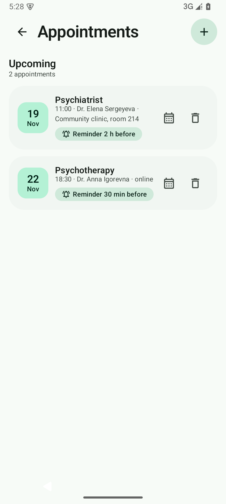

# Anchor

A local-first Android app for mood tracking, medication reminders, journaling
and doctor appointments. No ads, analytics, accounts or mandatory cloud.

**Beta 1.0.0 · Android 8.0+ · English and Russian**

## Install

**[Download the Android APK](https://github.com/SavaStone/Anchor/releases/download/v1.0.0-beta/Anchor-1.0.0-beta.apk)** · 3.70 MB

1. Open the [release page](https://github.com/SavaStone/Anchor/releases/tag/v1.0.0-beta) on your Android device.
2. Under **Assets**, download **Anchor-1.0.0-beta.apk**.
3. Open the downloaded file. If Android asks, allow your browser or file manager
   to install apps from this source, then confirm installation.
   You can turn that permission off afterward.

While the repository is private, you need a GitHub account with access to download.
Updates require a matching signing key. Do not uninstall an existing app containing
personal data without a verified backup.

## What you can do

| Section | Features |
|---|---|
| Today | Mood check-in, scheduled doses, journal and your next appointment; customizable blocks. |
| Mood | Calendar, charts and weekly summaries with sleep, energy, anxiety, emotions, symptoms and notes. |
| Medication | Scheduled or as-needed medication, stock tracking, dose history and reminders. |
| Journal | Notes with mood and tags, pinning, search and autosave. |
| Appointments | Doctor visits, notes, reminders and export to your system calendar. |
| Doctor report | A PDF for a selected period, with journal entries optionally included. |
| Backups | Encrypted export/import, automatic folder backups and optional WebDAV sync. |

Light/dark themes, system colors, large text, left-handed mode and customizable
navigation are supported. Optional app lock uses your device biometrics or screen
lock; screenshot protection is available separately.

## Screenshots

Actual app screens with fictional records generated by the built-in demo mode.
No personal health records are shown.

<p>
  
  
  
  
  
</p>

## Your data

Records stay on your device by default. Android cloud backup is disabled.
The local Room database is **not encrypted by the app**; app lock protects access
through the interface. Encrypted backup files use PBKDF2 + AES-GCM.

Auto-backup keeps up to seven files in a folder you choose. WebDAV is optional;
its backup encryption password is separate from the server login password.
Unencrypted JSON and PDF exports may contain sensitive information.

Bug reports are never sent automatically. Review their text and attachments:
automatic removal of personal data from logs is best effort.
See [Data and privacy](PRIVACY.md) for details.

## Beta notes

- This app does not diagnose, prescribe treatment or replace a doctor.
  Do not rely on it as your only medication reminder or medical record.
- Reminder timing depends on Android permissions and device restrictions.
- Keep a verified external backup and remember its password.
- Current checks: 154 JVM tests and 9 targeted Android bug-report tests passed;
  lint reported 0 errors and 24 warnings. The full Android test suite was not rerun.

See the [changelog](CHANGELOG.md) for release details and the APK checksum.

## Build and contribute

Open the project in Android Studio with **JDK 17** and **Android SDK 35**:

```sh
./gradlew :app:assembleDebug
```

The debug APK is at `app/build/outputs/apk/debug/app-debug.apk`.
It uses a different signing key from the official release.
See [Contributing](CONTRIBUTING.md) for checks, compatibility rules and test-device safety.
The official signing key is not included.

## Author and feedback

- [SavaStone on YouTube](https://www.youtube.com/@SavaStone)
- [SavaStone on GitHub](https://github.com/SavaStone)
- Bug reports: **More → Report a problem** in the app, or **savastone32@proton.me**.
- Security issues: follow [SECURITY.md](SECURITY.md); do not post vulnerabilities
  or personal medical data in public issues.

## License

A source-code license has not been selected. Access to this repository does not
grant redistribution rights; licensing must be decided before public publication.
