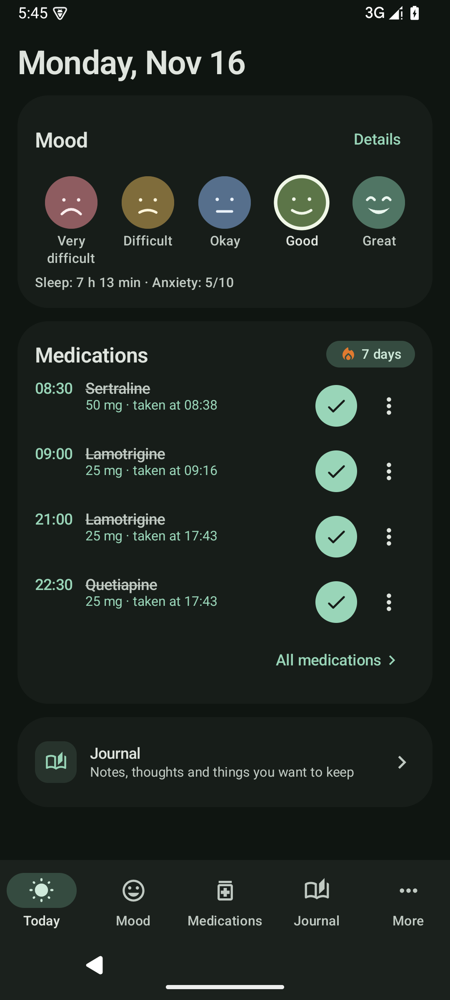
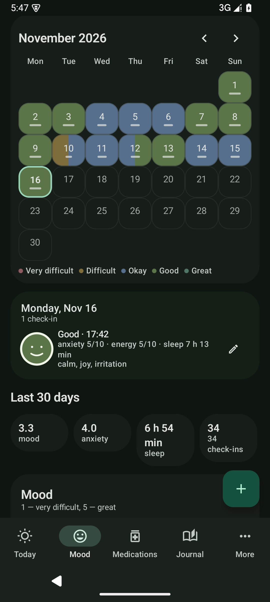
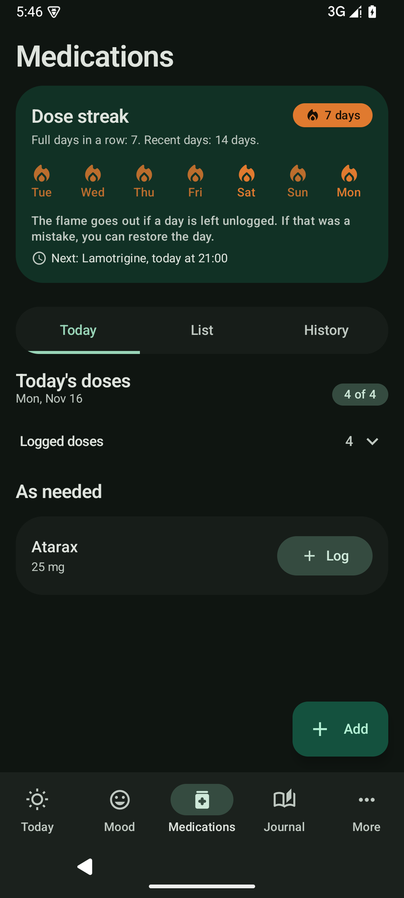
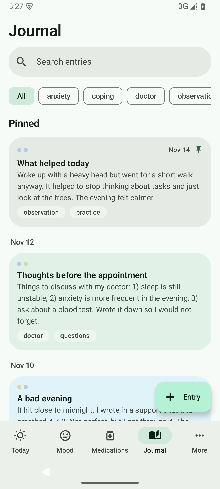

# Anchor

A local-first Android app for mood tracking, medication reminders, journaling
and doctor appointments. No ads, analytics, accounts or mandatory cloud.

**1.0.1-beta · Android 8.0+ · English and Russian**

**Development note:** This project was vibe-coded with AI assistance.

## Install

**[Download the Android APK](https://github.com/SavaStone/Anchor/releases/download/v1.0.1-beta/Anchor-1.0.1-beta.apk)**

1. Open the [release page](https://github.com/SavaStone/Anchor/releases/tag/v1.0.1-beta) on your Android device.
2. Under **Assets**, download **Anchor-1.0.1-beta.apk**.
3. Open the downloaded file. If Android asks, allow your browser or file manager
   to install apps from this source, then confirm installation.
   You can turn that permission off afterward.

While the repository is private, you need a GitHub account with access to download.
Updates require a matching signing key. Do not uninstall an existing app containing
personal data without a verified backup.

The release includes `SHA256SUMS.txt` for checking the downloaded file
(`shasum -a 256 Anchor-1.0.1-beta.apk` on macOS). A checksum detects a mismatched
download; it is not a substitute for Android's signing-key verification.

**Moving from the old `app.opora` installation:** the Android application ID changed from `app.opora`
to `io.github.savastone.anchor`. Android installs this version as a separate app;
it does not update or automatically copy data from the old one. Export an encrypted
backup in the old app and import it in the new app. Keep the old installation until
you have checked the imported records. Reconfigure reminders, app lock, backup-folder
access and optional WebDAV in the new app; do not assume permissions or credentials
transfer automatically.

## What you can do

| Section | Features |
|---|---|
| Today | Mood check-in, scheduled doses, journal and your next appointment; customizable blocks. |
| Mood | Calendar, charts and weekly summaries with sleep, energy, anxiety, emotions, symptoms and notes. |
| Medication | Scheduled or as-needed medication, stock tracking, dose history and reminders. |
| Journal | Notes with mood and tags, pinning, search and autosave. |
| Appointments | Doctor visits, notes, reminders and export to your system calendar. |
| Doctor report | A PDF for a selected period, with journal entries optionally included. |
| Backups | Encrypted export/import, automatic folder backups and optional WebDAV sync. |

Light/dark themes, system colors, large text, left-handed mode and customizable
navigation are supported. Optional app lock uses your device biometrics or screen
lock; screenshot protection is available separately.

## Screenshots

Actual app screens in dark theme, using fictional demo records and example
interactions. The seven-day streak uses the app's day-restoration feature.
No personal health records are shown.
The migration-test database also contains fictional demo records.
Screenshots illustrate the app and may differ from the latest beta.

<p>
  
  
  
  
  
</p>

## Your data

Records stay on your device by default. Android cloud backup is disabled.
The local Room database is **not encrypted by the app**; app lock protects access
through the interface. Encrypted backup files use PBKDF2 + AES-GCM.

Auto-backup keeps up to seven files in a folder you choose. WebDAV is optional;
its backup encryption password is separate from the server login password.
Unencrypted JSON and PDF exports may contain sensitive information.

Bug reports are never sent automatically. Review their text and attachments:
automatic removal of personal data from logs is best effort.
See [Data and privacy](PRIVACY.md) for details.

## Beta notes

- This app does not diagnose, prescribe treatment or replace a doctor.
  Do not rely on it as your only medication reminder or medical record.
- Reminder timing depends on Android permissions and device restrictions.
- Keep a verified external backup and remember its password.
- Verification is release-specific. See the changelog for executed checks and
  known gaps; a successful build is not a full security audit or a guarantee
  that reminders will run on every device.

See the [changelog](CHANGELOG.md) for release details and the APK checksum.

## Build and contribute

Open the project in Android Studio with **JDK 17** and **Android SDK 35**.
Install platform 35 and the required build tools through SDK Manager, let Gradle
sync finish, then run:

```sh
./gradlew :app:assembleDebug
```

The debug APK is at `app/build/outputs/apk/debug/app-debug.apk`.
It uses a different signing key from the official release.
See [Contributing](CONTRIBUTING.md) for checks, compatibility rules and test-device safety.
The official signing key is not included.
For command-line setup and CI checks, see [Contributing](CONTRIBUTING.md).

## Author and feedback

- [Sava Stone on YouTube](https://www.youtube.com/@SavaStone)
- Bug reports: [open an issue](https://github.com/SavaStone/Anchor/issues/new/choose)
  or email **savastone32@proton.me**. Include the report text prepared via
  **More → Report a problem** in the app, after reviewing it for personal information.
- Security issues: follow [SECURITY.md](SECURITY.md); do not post vulnerabilities
  or personal medical data in public issues.

## License

Licensed under the [MIT License](LICENSE). Copyright © 2026 Sava Stone.
Dependencies retain their own licenses; see [Third-party notices](THIRD_PARTY_NOTICES.md).
